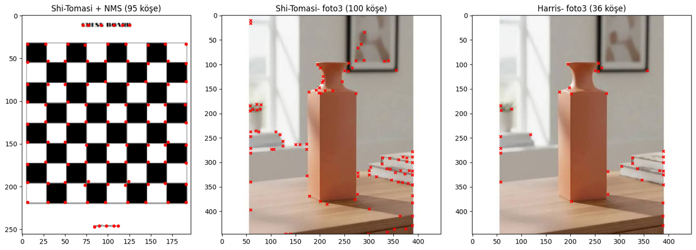
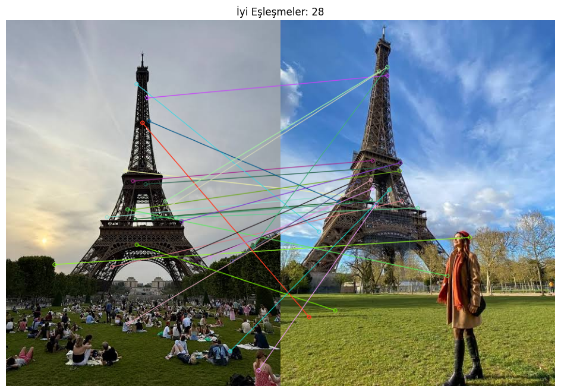
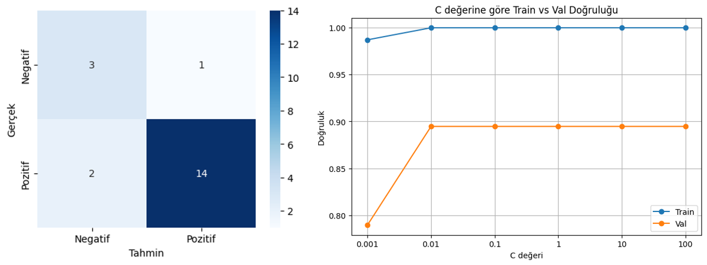
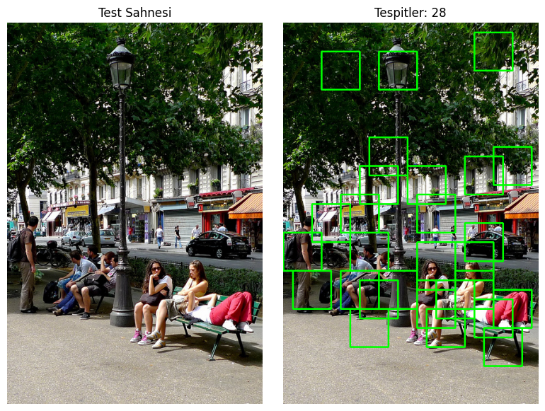
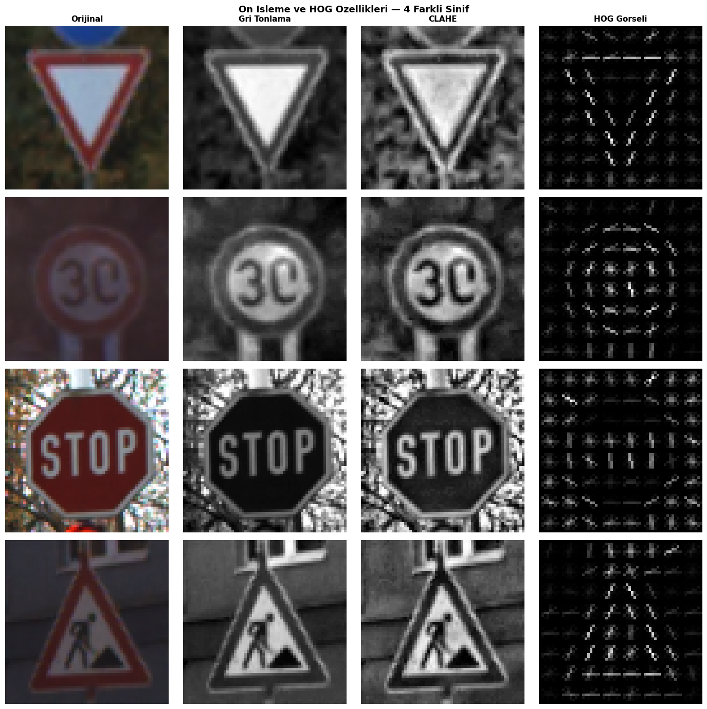
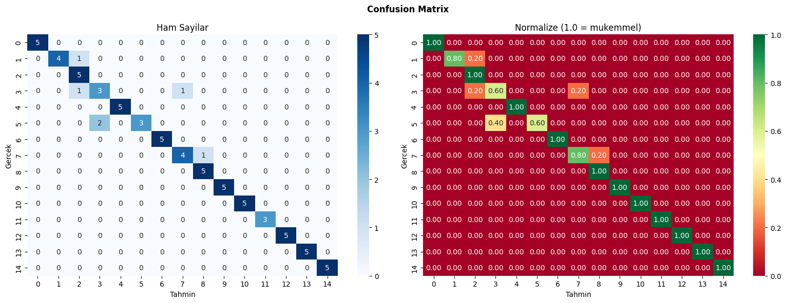
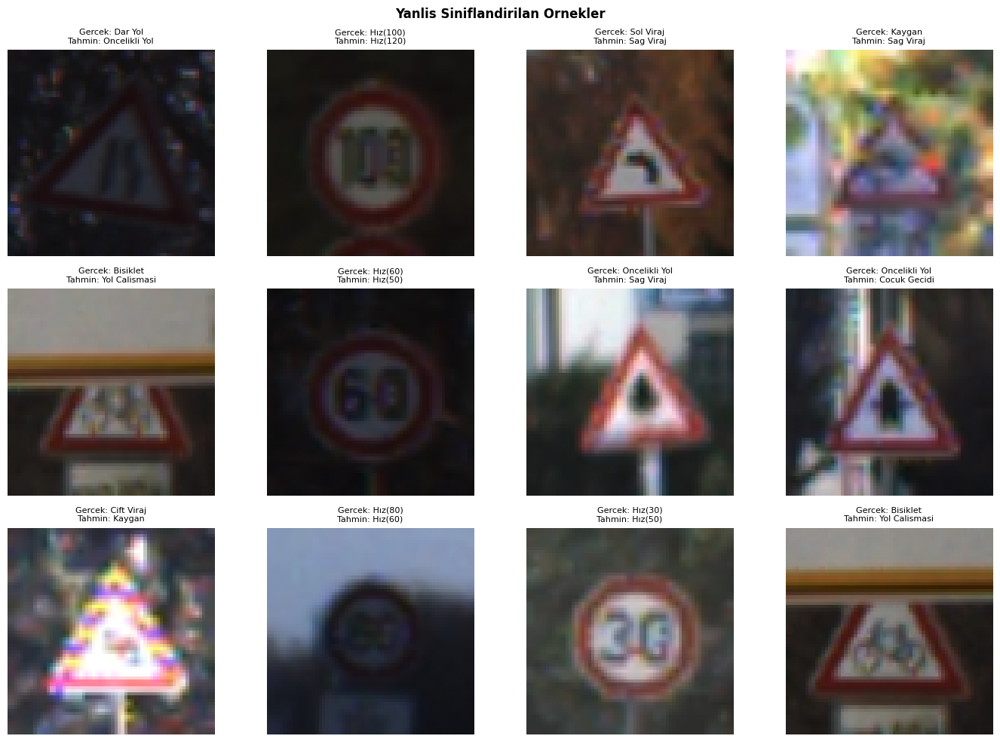

# Klasik Bilgisayarlı Görü: Köşe Tespitinden Nesne Tespitine

KOÜ Görüntü İşleme Laboratuvarı stajımda (Temmuz–Ağustos 2026) derin öğrenme kullanmadan, klasik yöntemlerle adım adım kurduğum görüntü işleme çalışmaları. Köşe tespitinden başlayıp öznitelik eşleştirme, HOG + SVM ile nesne tespiti ve 43 sınıflı trafik levhası sınıflandırmasına kadar ilerliyor.

> **EN:** Classical computer vision work from my internship at the KOU Image Processing Lab: hand-implemented Harris / Shi-Tomasi corner detection, SIFT matching with Lowe's ratio test, a HOG + SVM bicycle detector with sliding window and NMS, and 43-class traffic sign classification on GTSRB (92.6% test accuracy).

## Özet

| # | Çalışma | Yöntem | Sonuç |
|---|---|---|---|
| 1–3 | Köşe tespiti | Harris ve Shi-Tomasi, sıfırdan (gradyan → yapı tensörü → özdeğerler → NMS) | Satranç tahtasında 90–95 köşe; gerçek fotoğraflarda iki yöntemin karşılaştırması |
| 4 | Öznitelik eşleştirme | SIFT + BFMatcher + Lowe ratio test | 1337 ham eşleşmeden 28 iyi eşleşme |
| 5 | Bisiklet tespiti | HOG + lineer SVM + sliding window + NMS (COCO 2017) | Test: Accuracy 0.85, Precision 0.93, Recall 0.88, F1 0.90 |
| 6 | Trafik levhası sınıflandırma | CLAHE + HOG + RBF SVM (GTSRB, 43 sınıf) | Test: Accuracy %92.6, Precision %93.5, Recall %92.6, F1 %92.5 |

---

## 1–3. Harris ve Shi-Tomasi Köşe Tespiti

Hazır `cv2.cornerHarris` yerine adımları kendim yazdım:
1. Sobel ile x ve y gradyanları (`Ix`, `Iy`)
2. `Ixx`, `Iyy`, `Ixy` çarpımlarının 5×5 pencerede toplanması (yapı tensörü)
3. **Harris:** `R = det(M) − α·trace(M)²` · **Shi-Tomasi:** `R = min(λ1, λ2)`
4. Eşikleme (`0.01 × max`) ve non-maximum suppression



**Gözlemler**
- Satranç tahtası gibi keskin köşelerde iki yöntem de neredeyse aynı sonucu veriyor (α = 0.02 / 0.03 / 0.04 için 92 / 91 / 90 köşe).
- Gerçek fotoğrafta Shi-Tomasi dokulu yüzeylerde (ahşap masa) çok daha fazla köşe buluyor (100'e karşı 36). Bu köşelerin bir kısmı gerçek köşe değil, dokudan gelen yanlış pozitifler.
- α büyüdükçe Harris daha seçici oluyor ve daha az köşe döndürüyor.

## 4. SIFT ile Öznitelik Eşleştirme

Aynı yapının (Eyfel Kulesi) ışığı ve ön planı farklı iki fotoğrafı arasında SIFT anahtar noktaları çıkarıp Brute-Force Matcher ile eşleştirdim. Yanlış eşleşmeleri elemek için Lowe'un ratio test'ini 0.75 ve 0.8 eşikleriyle karşılaştırdım.



**Gözlemler**
- 1337 ve 1751 anahtar nokta, ratio test sonrası 28 iyi eşleşme kaldı.
- Eşleşmelerin çoğu kulenin yapısında, ama birkaçı çimen ve insanlar gibi tekrarlayan dokulara kayıyor. Ratio eşiğini yükseltmek recall'u artırırken precision'ı düşürüyor.

## 5. HOG + SVM ile Bisiklet Tespiti (COCO 2017)

Uçtan uca klasik bir nesne tespit hattı:
1. **Veri:** COCO 2017'den bisiklet içeren görüntüler (pozitif, kırpılmış kutular) ve kedi / araba / köpek içerip bisiklet içermeyen görüntüler (negatif)
2. **Öznitelik:** 64×64 gri görüntü → HOG (8×8 hücre, 2×2 blok) → 1764 boyutlu vektör
3. **Sınıflandırıcı:** Lineer SVM; C değeri 0.001–100 aralığında taranıp doğrulama setine göre seçildi
4. **Tespit:** 64×64 kayan pencere (adım 16 px) + IoU eşiği 0.3 ile NMS



| Set | Accuracy | Precision | Recall | F1 |
|---|---|---|---|---|
| Test | 0.85 | 0.93 | 0.88 | 0.90 |



**Gözlemler ve sınırlamalar**
- Kırpılmış görüntülerde sınıflandırma iyi çalışıyor, ancak tam sahnede çok sayıda **yanlış pozitif** çıkıyor. Ağaç dalları ve insan bacakları gibi çizgisel yapılar HOG'da bisiklete benziyor.
- Veri seti küçük (194 örnek) ve test seti 20 görüntü. Sonuçlar bu ölçekte yorumlanmalı.
- Tek ölçekli pencere farklı boyuttaki bisikletleri kaçırıyor. Görüntü piramidi ve hard negative mining sonraki adımlar.
- Bu sınırlamalar, aynı problemi derin öğrenme tabanlı tespit (YOLO) ile çözmenin neden standart hâline geldiğini net biçimde gösteriyor.

## 6. GTSRB Trafik Levhası Sınıflandırma (43 sınıf)

1. **Veri:** German Traffic Sign Recognition Benchmark, her sınıftan 50 görüntü (toplam 2150) → %80 eğitim / %10 doğrulama / %10 test
2. **Ön işleme:** 64×64'e yeniden boyutlandırma → gri tonlama → CLAHE (kontrast eşitleme) → normalizasyon
3. **Öznitelik:** HOG (9 yön, 8×8 hücre, 2×2 blok, L2-Hys)
4. **Sınıflandırıcı:** RBF çekirdekli SVM (C = 10)



| Set | Accuracy | Precision | Recall | F1 |
|---|---|---|---|---|
| Eğitim | %100.00 | %100.00 | %100.00 | %100.00 |
| Doğrulama | %91.63 | %92.94 | %91.63 | %91.71 |
| **Test** | **%92.56** | **%93.54** | **%92.56** | **%92.45** |





**Gözlemler**
- 215 test görüntüsünden 16'sı yanlış sınıflandı. Hataların çoğu birbirine çok benzeyen hız sınırı levhalarında (60 → 50, 80 → 60, 30 → 50, 100 → 120) ve aynı kırmızı üçgen çerçeveyi paylaşan uyarı levhalarında (bisiklet → yol çalışması, sol viraj → sağ viraj). HOG, levhanın dış şeklini iyi yakalıyor ama içindeki küçük rakam ve sembol farklarını ayırt etmekte zorlanıyor.
- Bulanık, karanlık veya düşük çözünürlüklü görüntüler hataların büyük kısmını oluşturuyor. CLAHE kontrastı artırsa da bu örneklerde yetersiz kalıyor.
- Eğitimde %100, testte %92.6 doğruluk hafif bir aşırı öğrenmeye işaret ediyor. Sınıf başına daha fazla örnek ve veri artırımı ilk iyileştirme adımları olur.

---

## Klasör Yapısı

```
notebooks/
├── 01_shi_tomasi_kose_tespiti.ipynb
├── 02_harris_alpha_analizi.ipynb
├── 03_harris_vs_shi_tomasi.ipynb
├── 04_sift_eslestirme.ipynb
├── 05_hog_svm_bisiklet_tespiti.ipynb
└── 06_gtsrb_trafik_levhasi_siniflandirma.ipynb
images/          # README'deki sonuç görselleri
```

## Çalıştırma

Notebook'lar Google Colab'da yazıldı ve doğrudan Colab'da açılıp çalıştırılabilir. Görüntüler `files.upload()` ile yükleniyor. COCO anotasyonları notebook içinde indiriliyor. GTSRB için bir Kaggle API anahtarı (`kaggle.json`) gerekiyor.

**Kullanılan kütüphaneler:** OpenCV · NumPy · SciPy · scikit-image · scikit-learn · pycocotools · Matplotlib · Seaborn
